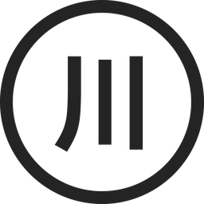
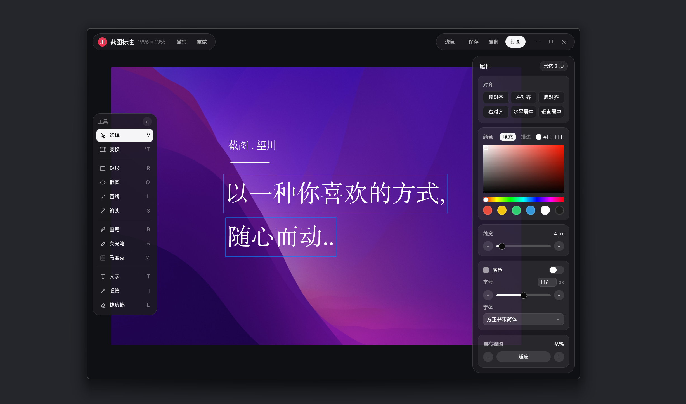
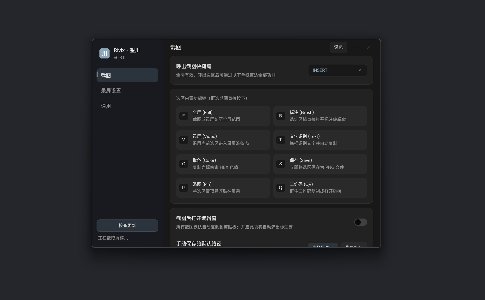

# Rivix · 望川



**看到 → 截取 → 留存；静可拾景，动可望川。**

基于 **Rust + [rgpui](https://crates.io/crates/rgpui)** 构建的原生轻量级截图与录屏工具。常驻托盘、毫秒级唤起、单热键分叉直达高频动作，截完即粘、录屏稳健、标注顺手。

[](https://github.com/kelsoz/Rivix/actions/workflows/ci.yml)
[](https://github.com/kelsoz/Rivix/releases)
[](LICENSE-APACHE)




---

## 为什么做「望川」？

好用的截图工具并不多，兜兜转转往往只剩两种妥协：

- **太简陋**：多屏混合 DPI 缩放发虚、HDR 色彩发灰、标注工具粗糙难用；
- **太臃肿**：设置页塞满几十个开关，启动慢、唤起卡，后台常驻吃掉几百兆内存。

「望川（Rivix）」源自开源 Rust 项目 **[rupix](https://github.com/launcher-rs/rupix)**。在继承其无 Electron、无 WebView 轻量骨架的基础上，我们从 UI 视觉、交互动线到多屏渲染与标注引擎做了一轮彻底重塑：

> **「拾景」是静态的定格，「望川」则是流水般的动态。**  
> 在静帧截图、贴图与矢量标注之外，望川集成了由 **FFmpeg** 驱动的轻量录屏能力，从瞬时定格到流畅录制，始终保持克制、稳定与高效。

> **绿色免安装 · 极简便携**：  
> 无需安装向导，不写杂乱系统目录。核心程序仅为**单个 `rivix.exe`（约 17 MB）**，配置文件 `rivix-config.json` 与程序同目录存放；截图、标注、Pin 图、取色、扫码全部单文件开箱即用，仅录屏时按需调用同目录或 `PATH` 中的 `ffmpeg.exe`。

---

## 设计哲学：一个入口，万千分支

好的效率工具，不该强迫人背诵五六个全局热键，也不该在每次截完图后弹出笨重的大窗口。

望川遵循一条符合肌肉记忆的主线：**一个热键唤起，过程中随心分叉。**

1. **单一入口唤醒**：只需记住 `Insert`（可在设置中自定义），全屏瞬间定格，鼠标悬停即可自动吸附窗口边界。
2. **高频路径零阻力**：框选后**松开左键即复制**，焦点不离开当前文档或 IDE，直接 `Ctrl + V` 粘贴；右下角仅浮起一枚轻巧的提示胶囊，绝不打断思路，也不会被下一张截图录进去。
3. **指尖直达进阶分支**：所有按键都严格对应动作的英文首字母或设计软件肌肉记忆，**见字知意、符合直觉**——框选期间只需轻按一个键即可原地切换：
   - **`Space`（按住 · 空格抓手）**：平移整个选区，松开继续微调大小（延续设计软件按住空格拖动画布的直觉）
   - **`F`（Fullscreen）**：一键选中当前显示器全屏
   - **`B`（Brush · 涂鸦标注）**：进入**矢量标注编辑器**
   - **`P`（Pin · 置顶钉图）**：**Pin 图贴纸**——将选区置顶钉在屏幕上（支持滚轮缩放与快捷关闭）
   - **`T`（Text · 文本提取）**：**OCR 识字**——原地识别文字并直接写入剪贴板，不弹窗不打断（支持自定义本地/在线引擎）
   - **`C`（Color · 颜色采样）**：**屏幕取色**——跟随式迷你色卡与像素放大镜，点击即复制 `HEX`
   - **`Q`（QR Code · 扫码）**：**二维码识别**——冻结画面内自动定位二维码并直达网页链接
   - **`S`（Save · 保存）**：将当前选区直接保存为 PNG 文件
   - **`V`（Video · 录屏）**：就地切入**录屏准备态**——自由调节比例与尺寸，`Enter` 开始录制

不用死记硬背复杂的组合键，所想即所按，一切顺着视线自然发生。



---

## 核心能力

### 1. 疾风般的速度、稳定性与极低资源占用
- **Rust 原生性能**：无 Electron、无 WebView，基于原生 GPU 渲染管线，托盘常驻内存极低，按下热键毫秒级响应定格。
- **多屏与 HDR 精确还原**：原生适配多显示器混合 DPI 缩放与 HDR 屏幕色彩映射，4K 画面下依然流畅跟手。
- **桌面置顶贴图（Pin）**：把参考图、报错截图或设计稿钉在屏幕最前，支持多张并存、滚轮缩放、双击还原原尺寸、右键快捷复制与关闭。
- **高度可定制的 OCR（本地引擎 + 在线 API）**：支持在设置中自由接入自定义 OCR 引擎——既可外接独立本地引擎（无论是轻量秒速的 RapidOCR + CUDA 加速，还是自装的高精度智能 OCR 引擎都能随习惯配置），按需唤醒、模型复用且空闲 3 分钟自动退出（平时零内存占用）；也支持填写在线 OCR API，兼顾本地极速隐私与云端强力识别。
- **命令行集成**：支持 `rivix -f`（全屏）、`rivix -r x,y,w,h`（区域）与 `--copy`，方便接入自动化脚本。

### 2. 老牌 FFmpeg 驱动的轻量录屏
- **硬件加速与高可靠输出**：自动探测 `h264_nvenc` 硬件加速（无 N 卡自动平滑回退 CPU），支持分段防崩溃 MP4 与 GIF 输出，并支持系统音频 / 麦克风混音。
- **灵活录制框**：进入录屏准备态即可自由调节比例（16:9 / 9:16 等）与预设分辨率，所见即所录。

### 3. 顺手到细节的矢量标注编辑器
- **工具齐全**：支持选择、矩形（可调圆角）、椭圆、直线、箭头、画笔、荧光笔、马赛克、吸管、橡皮擦、文字（单行点按 / 拖框自动换行段落，支持系统字体下拉选择、独立背景与文字背后圆角描边）。
- **设计软件级排版与变换**：
  - 支持 **`Ctrl + A` 全选**、框选多选、**`Alt + 拖动` 快速复制**、**`Delete` / `Backspace` 删除**。
  - 支持多选 **6 向对齐**（顶 / 左 / 底 / 右 / 水平居中 / 垂直居中，支持 `Alt + W/A/S/D/H/V`）。
  - 支持 **`Shift + X` 互换填充与描边**（矩形 / 椭圆 / 多边形），直线 / 箭头 / 画笔默认直达描边，马赛克屏蔽颜色干扰。
  - 支持 **`Ctrl + T` 自由变换与角外旋转**，以及绘制/旋转时的 **`Shift` 角度约束**。
  - **元素可自由拖出画布之外**，导出时自动按底图范围洁净裁切；完成编辑可一键复制、保存或 **Pin 在屏幕上**。

---

## 快捷键速查

### 全局热键（可在「设置 → 快捷键」自定义）

| 默认热键 | 动作 |
| --- | --- |
| `Insert` | 唤起区域截图（悬停窗口点击即截该窗口） |
| 默认留空（可自定义） | 全屏截图（推荐通过 `Insert` → `F` 分支调用，也可按习惯绑定） |
| 默认留空（可自定义） | 屏幕取色（推荐通过 `Insert` → `C` 分支调用，也可按习惯绑定） |

### 框选阶段指尖分支（唤起后单键直达）

| 按键 | 记忆词根 | 动作 |
| --- | --- | --- |
| `Space`（按住） | 抓手平移 | 平移整个选区，松开继续微调大小 |
| `F` | **F**ullscreen | 一键选中当前显示器全屏 |
| `B` | **B**rush | 进入矢量标注编辑器 |
| `P` | **P**in | 置顶贴图钉在屏幕上 |
| `T` | **T**ext | 原地 OCR 识别文字并写入剪贴板 |
| `C` | **C**olor | 屏幕取色（点击复制 `HEX`） |
| `Q` | **Q**R Code | 识别冻结画面中的二维码 |
| `S` | **S**ave | 直接保存选区为 PNG 文件 |
| `V` | **V**ideo | 切入录屏准备态（`Enter` 开始录制） |
| `Esc` / 右键 | — | 取消本次截图并退出 |

> **设计师小彩蛋**：如果你平时习惯 **Adobe Illustrator / Figma**，打开标注编辑器后的操作手感和快捷键一定会让你**相见如故**（还藏了一点给客制化键盘与对齐控准备的小惊喜，等你亲自去试）。

<details>
<summary>展开查看标注编辑器常用快捷键（Adobe 风格直觉操作）</summary>

| 按键 | 动作 |
| --- | --- |
| `V` / `R` / `L` / `O` / `B` / `T` / `M` / `I` / `E` | 选择 / 矩形 / 直线 / 椭圆 / 画笔 / 文字 / 马赛克 / 吸管 / 橡皮擦 |
| `Ctrl + A` | 全选所有标注元素 |
| `Ctrl + T` | 自由缩放与角外旋转变换 |
| `Alt + 拖动` | 原地复制并拖动选中元素 |
| `Shift + 拖动 / 旋转` | 约束水平 / 垂直 / 45° 方向与角度 |
| `Shift + X` | 互换填充与描边（矩形 / 椭圆 / 多边形） |
| `Alt + W/A/S/D/H/V` | 多选 6 向对齐（顶 / 左 / 底 / 右 / 水平居中 / 垂直居中） |
| `[` / `]` | 步进调节描边粗细 |
| `Esc` | 编辑文字时：提交内容并切回选择工具；其他状态：取消 / 切回选择 |
| `Delete` / `Backspace` | 删除选中元素 |
| `Ctrl + Z` / `Ctrl + Shift + Z` (`Ctrl + Y`) | 撤销 / 重做 |
| `Ctrl + S` / `Ctrl + V` | 保存结果图 / 从剪贴板打开新图片标注 |
| `Space`（按住拖动） | 平移画布；`+` / `-` / `0` / 滚轮缩放 |

</details>

---

## 从源码构建

环境要求：

- Rust stable（`edition = "2024"`）
- Windows：MSVC 工具链（`.cargo/config.toml` 已配置静态 CRT）
- Linux：`libclang-dev libwayland-dev libxkbcommon-dev libxkbcommon-x11-dev libx11-dev libx11-xcb-dev libxcb1-dev libasound2-dev libudev-dev`

```bash
cargo build --release            # 正式构建（opt-level=3 + thin LTO + strip）
cargo build --profile size       # 最小体积构建（opt-level=z + fat LTO）
```

> 提示：日常使用请运行 `--release` 构建；`debug` 模式下 4K 冻结帧与矢量渲染未做优化，帧率会明显下降。提交代码前请确保 `cargo fmt --check`、`cargo clippy -- -D warnings` 与 `cargo test` 全部通过（详见 [AGENTS.md](AGENTS.md)）。

---

## 声明与开源协议

- **永远免费，开源自由**：本项目采用 [Apache-2.0](LICENSE-APACHE) 协议开源，永不收费、永无广告、永不捆绑。
- **欢迎交流与建议**：如果你在使用中遇到任何 Bug、有更顺手的交互想法，或希望支持新能力，欢迎提交 **Issue** 或 **Pull Request**。

---

## 请我喝一杯咖啡 ☕

写代码、抠细节、调色彩、修边界条件，很多灵感都是在深夜的一杯咖啡里攒出来的。  
如果「望川」刚好也为你省下了一点时间、让每天的截屏和录屏变得更惬意，欢迎请我喝一杯咖啡，支持它继续往前流淌：

<p align="left">
  
</p>

感谢每一位同行者。愿你所见皆清晰，所截皆顺心。
